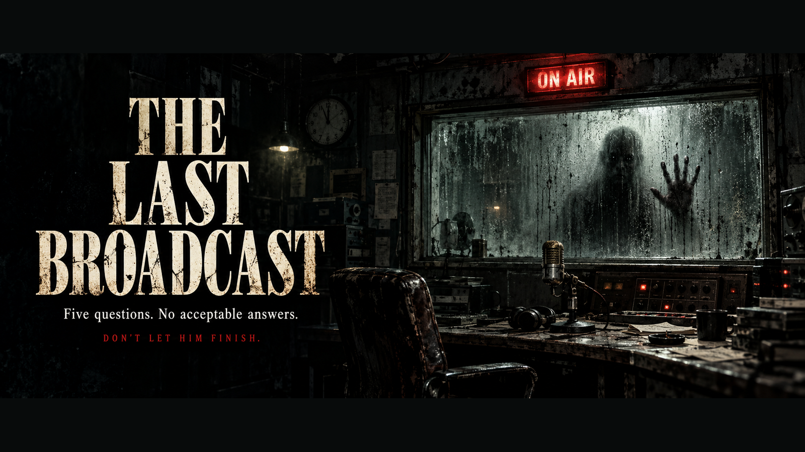

<p align="center">
  
</p>

<h1 align="center">THE LAST BROADCAST</h1>

<p align="center">
  <strong>An interactive radio nightmare.</strong><br/>
  Five questions. No acceptable answers.<br/>
  <em>Bring headphones. And a sense of humor. And maybe a therapist.</em>
</p>

<p align="center">
  
  
  
  
  
  
  
  
  
  
</p>

---

## Overview

A single-player, local-first, five-round interactive radio nightmare. The listener tunes into Channel 00. A presenter claims five answers can rescue Mara, a person trapped beyond the signal. Each answer is rejected for an invented bureaucratic reason. The listener gradually hears that this has happened before. The broadcast ends; Mara is lost into the fictional dark.

The experience is intentionally unwinnable. Its pleasure comes from the model reacting to the player's ingenuity, the captive challenging the host, and the listener discovering the rigged format. Think of it as a customer service nightmare where the customer is a hostage and the representative is an AI with a god complex and a thesaurus.

The point: a local open-weight model (Gemma 3 1B via Ollama) performs the answer-conditioned improvisation on the player's machine. Kokoro generates speech locally. Its model files may need to download on first use; cache them before playing offline. The game can be inspected and its story and voices replaced. Your secrets are safe. The station's aren't.

## Tech Stack

| Layer | Technology |
|-------|-----------|
| Frontend | React 18 + TypeScript + Vite |
| Styling | Inline styles, semantic HTML |
| Game Engine | Pure TypeScript reducer + injected clock |
| API | Node 24 LTS + Express + Zod 4 |
| Presenter | Ollama (Gemma 3 1B) — local open-weight model |
| Speech | Kokoro — local open-weight TTS |
| Fixed Audio | Local WAV + procedural SFX |
| State | In-memory per run |
| Tests | Vitest + Supertest + Playwright |
| Docs | Swagger / OpenAPI 3.0 |

## Setup

### Prerequisites

- Node 24 LTS
- Ollama (local)
- Gemma 3 1B model

### Install

```bash
# Pull the model
ollama pull gemma3:1b

# Install dependencies
npm ci

# Start dev server
npm run dev
```

For the development UI, open the tokenized URL printed by the API server, replacing port `4318` with `5174`. The token is carried in the URL fragment and removed from the address bar after the page loads.

### Production

```bash
npm run build
npm start
```

Open the tokenized `http://127.0.0.1:4318/#token=...` URL printed in your terminal.

## Scripts

| Command | Description |
|---------|-------------|
| `npm run dev` | UI on 5174 + API on 4318 |
| `npm run build` | Build all workspaces |
| `npm start` | Serve production build |
| `npm run typecheck` | Type-check all workspaces |
| `npm run lint` | Lint (not yet configured) |
| `npm run test` | Unit + HTTP integration tests |
| `npm run test:e2e` | Playwright E2E tests |
| `npm run probe:model` | Run one local Ollama inference and report its duration |
| `npm run doctor` | Check Node, episode content, audio assets and local model |

## API Documentation

Swagger UI available at `http://127.0.0.1:4318/api/docs/` (with app token).

Endpoints:
- `GET /api/health` — liveness check
- `GET /api/runtime` — check whether the configured local model is installed and whether speech is ready
- `POST /api/warmup` — load the configured model; returns 503 if it fails
- `POST /api/reaction` — generate host rejection
- `POST /api/speech` — synthesize speech with Kokoro
- `GET /api/audio/:id` — serve audio WAV

## Project Structure

```
├── apps/
│   ├── web/          # React/Vite frontend
│   └── server/       # Express API + Ollama adapter
├── packages/
│   ├── engine/       # Pure state machine + timing
│   └── contracts/    # Shared Zod schemas
├── content/          # Episode JSON + voice manifest
├── prompts/          # Presenter system prompt
├── tools/            # Model probe, voice prep
├── tests/            # Integration + E2E
└── planning/         # Spec and brand assets (local only)
```

## License

[MIT](LICENSE)
